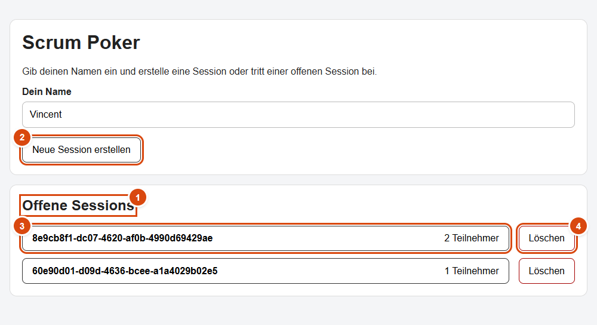
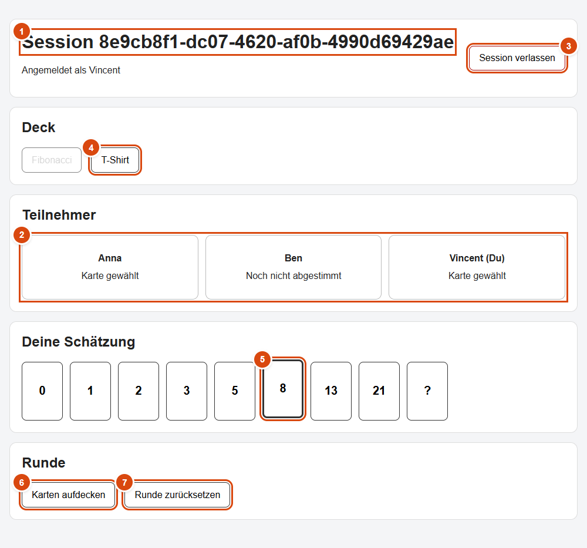
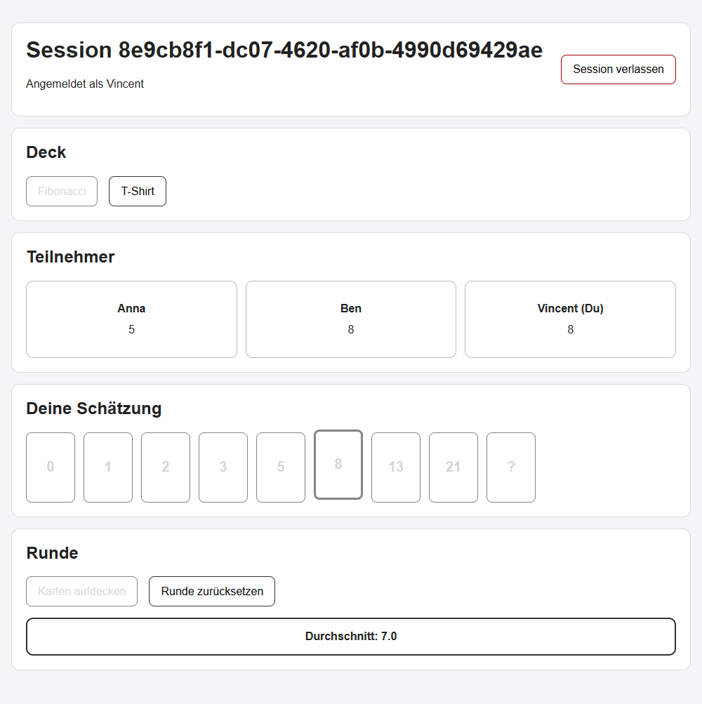

# Scrum Poker App

Eine bewusst einfach aufgebaute Full-Stack-Webanwendung für Planning Poker. Das Projekt besteht aus einem React-/TypeScript-Frontend und einem Node.js-/Express-Backend.

Der Fokus dieses Projekts liegt auf verständlichem Code. Deshalb werden keine zusätzlichen State-Management-Bibliotheken, keine Datenbank und keine WebSockets verwendet. Gemeinsame Session-Daten liegen im Express-Server und werden vom Frontend regelmässig per Polling abgefragt.

## 1. Projektstruktur

```text
scrum-poker-app/
├── client/                (Frontend, aufgebaut nach der Client-Vorlage des Dozenten)
│   ├── public/
│   │   └── favicon.svg
│   ├── src/
│   │   ├── api/
│   │   │   └── request.ts              Helfer aus der Vorlage: ein Ort für alle fetch-Aufrufe
│   │   ├── components/
│   │   │   ├── App.tsx                 Wurzelkomponente mit dem Routing
│   │   │   ├── Input.tsx               Textfeld (Vorlage), gibt den Text direkt weiter
│   │   │   ├── ParticipantCard.tsx/.css
│   │   │   ├── PokerCard.tsx/.css
│   │   │   ├── PokerTable.tsx/.css     Pokertisch einer Session (Polling, Aktionen)
│   │   │   ├── Sessions.tsx/.css       Liste der offenen Sessions
│   │   │   └── SessionRow.tsx          Ein Eintrag der Session-Liste
│   │   ├── hooks/
│   │   │   ├── useMutation.ts          Helfer aus der Vorlage: POST, PUT, DELETE
│   │   │   └── useQuery.ts             Helfer aus der Vorlage: GET mit optionalem Polling
│   │   ├── pages/
│   │   │   ├── HomePage.tsx/.css
│   │   │   ├── NotFoundPage.tsx
│   │   │   └── SessionPage.tsx
│   │   ├── types/
│   │   │   └── api.ts                  Types der Server-Antworten (Vorlage)
│   │   ├── utils/
│   │   │   ├── decks.ts                Karten der Decks und Deck-Buttons
│   │   │   ├── result.ts               Auswertung nach dem Aufdecken
│   │   │   └── username.ts             Name im localStorage lesen/schreiben
│   │   ├── config.ts                   Polling-Intervall
│   │   ├── index.css                   Globale Styles
│   │   └── main.tsx
│   ├── .oxlintrc.json, .prettierrc
│   ├── index.html
│   ├── package.json
│   ├── tsconfig.json, tsconfig.app.json, tsconfig.node.json
│   └── vite.config.ts
├── server/                (bereitgestellte Server-Vorlage der HWZ, unverändert)
│   ├── src/
│   │   ├── routes/
│   │   │   └── sessions.ts
│   │   ├── decks.ts
│   │   ├── server.ts
│   │   ├── store.ts
│   │   ├── types.ts
│   │   └── views.ts
│   ├── package.json
│   ├── README.md
│   ├── requests.http
│   └── tsconfig.json
├── docs/
│   └── screenshots/       Screenshots für die API-Skizze (Abschnitt 4)
├── .gitignore
└── README.md
```

## 2. Frontend

Das Frontend verwendet die Helfer aus der Client-Vorlage des Dozenten (`request`, `useQuery`, `useMutation`) und dieselben Tools (Vite, TypeScript, oxlint, Prettier). Die Dateien `api/request.ts`, `hooks/useQuery.ts`, `hooks/useMutation.ts` und `types/api.ts` sind unverändert aus der Vorlage übernommen.

### Komponentenbaum

```text
main.tsx
└── App                       (components/App.tsx, Routing)
    ├── HomePage              /
    │   ├── Input
    │   └── Sessions
    │       └── SessionRow    (eine pro Session, key = Session-ID)
    ├── SessionPage           /sessions/:sessionId
    │   ├── Input             (nur wenn noch kein Name gespeichert ist)
    │   └── PokerTable        (erst nach dem Beitreten)
    │       ├── ParticipantCard   (eine pro Teilnehmer)
    │       └── PokerCard         (eine pro Karte)
    └── NotFoundPage          *
```

### `client/src/main.tsx`

Einstiegspunkt. Sucht das Element mit der ID `root` und rendert dort `<App />`.

### `client/src/components/App.tsx`

Routing mit React Router (optionale Erweiterung, Abschnitt 3.4 der Vorgaben):

- `/` zeigt die Home-Seite.
- `/sessions/:sessionId` zeigt eine bestimmte Poker-Session.
- `*` fängt alle unbekannten URLs ab und zeigt die 404-Seite.

Die Session-ID ist Teil der URL und kann geteilt oder als Bookmark gespeichert werden.

### `client/src/api/request.ts`

Ein Ort für alle Server-Anfragen. `request()` wirft nie, sondern gibt immer ein Ergebnis-Objekt zurück:

- Erfolg: `{ data: ..., error: null }`
- Fehler: `{ data: null, error: 'Meldung' }`

Ist der Server nicht erreichbar, kommt `Server not reachable.` zurück. Sonst wird die Meldung aus `{ "error": "..." }` gelesen. Antworten mit Status 204 haben keinen Body.

### `client/src/hooks/useQuery.ts`

Lädt Daten per `GET`, sobald die Komponente gemountet wird. Mit `{ pollMs }` wird regelmässig neu geladen (Polling). Das Intervall wird in der Cleanup-Funktion von `useEffect` wieder entfernt. `isLoading` ist nur bis zur ersten Antwort `true`, damit das Polling nicht flackert. Bei einem Fehler bleiben die letzten Daten erhalten. `refetch()` lädt sofort neu (z. B. nach einer Abstimmung).

### `client/src/hooks/useMutation.ts`

Für Änderungen per Klick (`POST`, `PUT`, `DELETE`). Liefert `send(url, body)`, `isLoading` und `error`. Die URL wird erst beim Senden übergeben, deshalb deckt ein Hook viele Einträge ab (z. B. das Löschen beliebiger Sessions).

### `client/src/pages/HomePage.tsx`

Die Home-Seite ist der Einstieg in die App:

1. Benutzername eingeben und sofort in `localStorage` speichern (`utils/username.ts`).
2. Offene Sessions mit `useQuery` laden und alle drei Sekunden aktualisieren.
3. Neue Session erstellen (`useMutation('POST')`), danach mit `useNavigate()` zu `/sessions/<id>` wechseln.
4. Einer bestehenden Session beitreten (Klick auf einen Eintrag).
5. Eine Session löschen (`useMutation('DELETE')`), danach die Liste mit `refetch()` neu laden.
6. Leere Namen abfangen sowie Lade- und Fehlerzustände anzeigen.

Die Session-Daten liegen in der HomePage und werden per Props an `Sessions` weitergegeben (Lifting State Up), weil die HomePage nach dem Löschen die Liste neu laden muss.

### `client/src/pages/SessionPage.tsx`

1. `useParams()` liest die `sessionId` aus der URL.
2. Der Benutzername wird aus `localStorage` gelesen.
3. Falls noch kein Name gespeichert ist, kann er direkt hier eingegeben werden. Dadurch funktioniert auch ein erstmals geöffneter geteilter Link.
4. In einem `useEffect` sendet die Seite `POST /api/sessions/:id/participants` mit dem Namen (direkt über `request()`, weil `useMutation` für Klicks gedacht ist).
5. Die Teilnehmer-ID aus der Antwort wird im State gehalten.
6. Danach wird `PokerTable` gerendert.

### `client/src/components/PokerTable.tsx`

Der Pokertisch einer Session. Er wird erst nach dem Beitreten gerendert, dadurch startet das Polling erst mit einer bekannten Teilnehmer-ID.

- `useQuery<SessionView>` lädt die Session alle drei Sekunden neu.
- Je ein `useMutation` für Abstimmen, Aufdecken/Zurücksetzen, Deck-Wechsel und Verlassen. Nach jeder erfolgreichen Aktion lädt `refetch()` die Session sofort neu.
- Weil der Server die Stimmen bis zum Aufdecken verdeckt (auch die eigene), merkt sich die Komponente die eigene Karte im State `myVote`. Ein zweiter Klick auf die gewählte Karte nimmt sie zurück (`vote: null`).
- Abgeleitete Werte (eigener Teilnehmer, markierte Karte, Karten des Decks, Auswertung) werden bei jedem Render berechnet und nicht separat im State gehalten.
- Beim Unmount und beim Schliessen des Tabs wird der Teilnehmer serverseitig entfernt (siehe Abschnitt 13).

### `client/src/components/Sessions.tsx` und `SessionRow.tsx`

`Sessions` wandelt die Liste in `SessionRow`-Komponenten um (`key` = Session-ID). `SessionRow` zeigt ID und Teilnehmerzahl sowie einen Löschen-Button. Beide Komponenten kennen die API nicht, sie melden Klicks über die Props `onJoin` und `onDelete` nach oben.

### `client/src/components/PokerCard.tsx`

Eine auswählbare Pokerkarte mit den Props `value`, `selected`, `disabled` und `onClick`. Die Komponente kennt weder die Session noch die API.

### `client/src/components/ParticipantCard.tsx`

Zeigt einen Teilnehmer am Pokertisch. Vor dem Reveal wird nur angezeigt, ob bereits eine Karte gewählt wurde. Nach dem Reveal wird der gewählte Wert angezeigt.

### `client/src/components/Input.tsx`

Textfeld aus der Vorlage. Es versteckt das Change-Event: Die Elternkomponente bekommt den Text direkt. Ergänzt um die optionale Prop `id`, damit das Feld mit einem `<label>` verbunden werden kann.

### `client/src/types/api.ts`

Die Types der Server-Antworten (`DeckId`, `SessionSummary`, `ParticipantView`, `SessionView`). Sie entsprechen den Antwort-Types in `server/src/types.ts`.

### `client/src/utils/`

- `decks.ts`: Karten der beiden Decks (wie im Server) und die Deck-Buttons.
- `result.ts`: `getResultText()` berechnet die Auswertung nach dem Aufdecken (siehe Abschnitt 9).
- `username.ts`: Lesen und Schreiben des Namens im `localStorage` (Schlüssel `username`).

### Styling

Globale Styles (Reset, Seitenlayout, Formulare, Meldungen) liegen in `index.css`. Styles einzelner Komponenten liegen direkt neben der Komponente (z. B. `PokerCard.css`). Das Layout verwendet Flexbox und CSS Grid. Durch `auto-fit`, `minmax()` und Media Queries funktioniert die Oberfläche auch auf kleinen Bildschirmen.

## 3. Backend

Das Backend ist die von der HWZ bereitgestellte Server-Vorlage (Express 5 + TypeScript). Node 24 führt die `.ts`-Dateien direkt aus, einen Build-Schritt gibt es nicht. Details stehen zusätzlich in `server/README.md`.

### `server/src/server.ts`

Startet Express auf Port 3000, hängt alle Routen unter `/api` ein und enthält einen 404- und einen Fehler-Handler. Fehler kommen immer als JSON `{ "error": "..." }` zurück.

CORS wird nicht benötigt: Im Entwicklungsmodus leitet der Vite-Proxy (`client/vite.config.ts`) alle Requests auf `/api` an `http://localhost:3000` weiter. Für den Browser liegen Frontend und Backend dadurch auf demselben Origin.

### `server/src/types.ts`

Trennt zwei Arten von Types:

- **Domain-Types** (`Participant`, `Session`): So speichert der Server die Daten.
- **Antwort-Types / DTOs** (`ParticipantView`, `SessionView`, `SessionSummary`, `ErrorResponse`): So sieht der Client die Daten.

`ParticipantView` enthält zusätzlich `hasVoted`. Die Frontend-Types in `client/src/types/api.ts` entsprechen diesen Antwort-Types.

### `server/src/store.ts`

Hier befindet sich der zentrale In-Memory-Speicher:

```ts
const sessions = new Map<string, Session>()
```

Der Schlüssel ist die Session-ID (eine UUID). Dazu kommen kleine Helfer wie `createSession()`, `addParticipant()`, `findParticipantByName()` oder `clearVotes()`.

Eine Datenbank wird bewusst nicht verwendet. Wird der Server neu gestartet, gehen alle Sessions verloren.

### `server/src/decks.ts`

Enthält die Karten der beiden Decks und die Funktion `isDeckId()`, die prüft, ob ein Wert aus dem Request-Body ein gültiges Deck ist.

### `server/src/views.ts`

Wandelt gespeicherte Daten in Antworten um. Hier werden die Stimmen verdeckt, solange die Runde nicht aufgedeckt ist.

### `server/src/routes/sessions.ts`

Enthält alle API-Routen.

## 4. API-Übersicht

Alle Pfade beginnen mit `/api`.

| Methode | Route | Body | Antwort | Fehler |
| --- | --- | --- | --- | --- |
| GET | `/sessions` | – | 200 `SessionSummary[]` | – |
| POST | `/sessions` | – | 201 `SessionView` | – |
| GET | `/sessions/:sessionId` | – | 200 `SessionView` | 404 |
| DELETE | `/sessions/:sessionId` | – | 204 | 404 |
| POST | `/sessions/:sessionId/participants` | `{ "name": "…" }` | 201 neu / 200 bekannt | 400, 404 |
| DELETE | `/sessions/:sessionId/participants/:participantId` | – | 204 | 404 |
| PUT | `/sessions/:sessionId/participants/:participantId/vote` | `{ "vote": "5" }` oder `{ "vote": null }` | 200 `ParticipantView` | 400, 404, 409 |
| PUT | `/sessions/:sessionId/revealed` | `{ "revealed": true }` / `false` | 200 `SessionView` | 400, 404 |
| PUT | `/sessions/:sessionId/deck` | `{ "deck": "tshirt" }` | 200 `SessionView` | 400, 404 |

Wo das Frontend welche Route aufruft:

| Komponente | Hook | Route |
| --- | --- | --- |
| `HomePage` | `useQuery` (Polling) | `GET /api/sessions` |
| `HomePage` | `useMutation('POST')` | `POST /api/sessions` |
| `HomePage` | `useMutation('DELETE')` | `DELETE /api/sessions/:sessionId` |
| `SessionPage` | `request()` im `useEffect` | `POST /api/sessions/:sessionId/participants` |
| `PokerTable` | `useQuery` (Polling) | `GET /api/sessions/:sessionId` |
| `PokerTable` | `useMutation('PUT')` | `PUT /api/sessions/:sessionId/participants/:participantId/vote` |
| `PokerTable` | `useMutation('PUT')` | `PUT /api/sessions/:sessionId/revealed` mit `true` / `false` |
| `PokerTable` | `useMutation('PUT')` | `PUT /api/sessions/:sessionId/deck` |
| `PokerTable` | `useMutation('DELETE')` bzw. `fetch` mit `keepalive` | `DELETE /api/sessions/:sessionId/participants/:participantId` |

### Skizze: Welcher Button welche API aufruft

Die Screenshots zeigen die laufende Applikation. Die orangen Nummern markieren die Elemente, die eine Route auf dem Server aufrufen.

#### Home-Seite (`/`)



| Nr. | Element | Methode und Route | Antwort | Was danach passiert |
| --- | --- | --- | --- | --- |
| 1 | Liste «Offene Sessions» (kein Button, automatisch) | `GET /api/sessions` | 200 `SessionSummary[]` | Wird beim Öffnen der Seite und danach alle 3 Sekunden geladen (Polling mit `useQuery`). Zeigt ID und Teilnehmerzahl. |
| 2 | Button «Neue Session erstellen» | `POST /api/sessions` | 201 `SessionView` | Der Name wird zuerst geprüft (nicht leer). Der Server erzeugt die ID, danach wechselt die App zu `/sessions/<id>`. |
| 3 | Klick auf einen Session-Eintrag | – (noch keine Route) | – | Der Name wird geprüft, dann wechselt die App zu `/sessions/<id>`. Das eigentliche Beitreten passiert auf der Session-Seite (siehe unten). |
| 4 | Button «Löschen» | `DELETE /api/sessions/:sessionId` | 204 / 404 | Danach wird die Liste mit `refetch()` sofort neu geladen. |

Das Namensfeld ruft keine Route auf: Der Name wird bei jeder Änderung nur im `localStorage` gespeichert.

#### Pokertisch (`/sessions/:sessionId`)



| Nr. | Element | Methode und Route | Body | Antwort | Was danach passiert |
| --- | --- | --- | --- | --- | --- |
| 1 | Öffnen der Seite (automatisch) | `POST /api/sessions/:sessionId/participants` | `{ "name": "Vincent" }` | 201 neu / 200 bekannt / 404 | Meldet den Benutzer am Tisch an. Die Teilnehmer-ID aus der Antwort wird gespeichert. Bei 404 erscheint «Session nicht verfügbar». |
| 2 | Teilnehmer, Deck, Reveal-Zustand (automatisch) | `GET /api/sessions/:sessionId` | – | 200 `SessionView` / 404 | Alle 3 Sekunden (Polling mit `useQuery`). So sieht man Änderungen der anderen Teilnehmer. |
| 3 | Button «Session verlassen» | `DELETE /api/sessions/:sessionId/participants/:participantId` | – | 204 / 404 | Danach Wechsel zur Home-Seite. Derselbe Request wird beim Schliessen des Tabs automatisch gesendet (`keepalive`). |
| 4 | Buttons «Fibonacci» / «T-Shirt» | `PUT /api/sessions/:sessionId/deck` | `{ "deck": "tshirt" }` | 200 `SessionView` | Der Server startet eine neue, verdeckte Runde. Danach `refetch()`. |
| 5 | Pokerkarte (z. B. «8») | `PUT /api/sessions/:sessionId/participants/:participantId/vote` | `{ "vote": "8" }` bzw. `{ "vote": null }` | 200 `ParticipantView` / 409 | Die gewählte Karte wird im State `myVote` gemerkt. Ein zweiter Klick nimmt sie zurück (`null`). Die anderen sehen nur «Karte gewählt». |
| 6 | Button «Karten aufdecken» | `PUT /api/sessions/:sessionId/revealed` | `{ "revealed": true }` | 200 `SessionView` | Der Server schickt ab jetzt alle Stimmen mit. Danach `refetch()`. |
| 7 | Button «Runde zurücksetzen» | `PUT /api/sessions/:sessionId/revealed` | `{ "revealed": false }` | 200 `SessionView` | Der Server löscht alle Stimmen und verdeckt die Karten. Danach `refetch()`. |

#### Nach dem Aufdecken

Nach Button 6 liefert das nächste `GET /api/sessions/:sessionId` die Stimmen aller Teilnehmer. Die Auswertung (hier der Durchschnitt) berechnet das Frontend in `utils/result.ts`. Die Karten sind gesperrt, bis eine neue Runde startet (der Server würde sonst mit 409 antworten).



#### Ablauf eines Kartenklicks

```text
Klick auf Karte «8»                         (PokerCard → onClick)
  → handleVote('8')                         (PokerTable)
  → voteMutation.send(.../vote, { vote: '8' })
  → PUT /api/sessions/:sessionId/participants/:participantId/vote
  ← 200 { id, name, hasVoted: true, vote: null }
  → setMyVote('8') und sessionQuery.refetch()
  → GET /api/sessions/:sessionId
  ← 200 SessionView → React rendert die Karte als gewählt
```

## 5. Session erstellen

Bei `POST /api/sessions` erzeugt der Server mit `crypto.randomUUID()` eine eindeutige ID. Die ID wird vom Server erzeugt, nicht vom Client.

Eine neue Session startet mit:

```text
participants = []
deck = fibonacci
revealed = false
```

Danach wird die Session in der `Map` gespeichert.

## 6. Beitreten

`POST /api/sessions/:sessionId/participants` erwartet einen Namen.

Beitreten ist **idempotent**: Der Name ist der Schlüssel. Tritt jemand mit einem Namen bei, der schon am Tisch sitzt, liefert der Server denselben Teilnehmer zurück (200 statt 201). Dadurch entstehen bei einem Reload keine doppelten Teilnehmer. Verglichen wird exakt (`Anna` und `anna` sind zwei Personen), Leerzeichen am Anfang und Ende werden entfernt.

## 7. Voting

Bei `PUT /api/sessions/:sessionId/participants/:participantId/vote` sendet das Frontend:

```json
{
  "vote": "5"
}
```

Mit `{ "vote": null }` wird die Karte zurückgenommen. PUT, weil der Client den ganzen Wert der Ressource «vote» ersetzt.

Der Server prüft, ob die Karte zum aktiven Deck gehört (sonst 400). Nach dem Aufdecken ist Abstimmen gesperrt (409), bis eine neue Runde startet.

Fibonacci:

```text
0, 1, 2, 3, 5, 8, 13, 21, ?
```

T-Shirt-Grössen:

```text
XS, S, M, L, XL
```

## 8. Verdeckte Karten

Solange eine Runde nicht aufgedeckt ist, schickt der Server die Stimmen **nicht** mit. Sonst könnte jeder die Karten der anderen im DevTools-Tab «Network» lesen. Das Feld `hasVoted` verrät nur, ob jemand abgestimmt hat.

Ein Teilnehmer mit `hasVoted === true` wird vor dem Reveal nur als `Karte gewählt` dargestellt. Erst wenn `session.revealed === true` ist, liefert der Server `vote` mit und `ParticipantCard` zeigt den tatsächlichen Wert.

Auch die eigene Karte kommt erst nach dem Aufdecken vom Server. Welche Karte man gewählt hat, merkt sich deshalb das Frontend (`myVote` in `PokerTable.tsx`).

## 9. Reveal und Auswertung

Mit `PUT /api/sessions/:sessionId/revealed` und `{ "revealed": true }` deckt der Server auf.

Die Auswertung wird danach im Frontend berechnet.

### Fibonacci

Bei numerischen Fibonacci-Werten wird der Durchschnitt berechnet. Die Karte `?` fliesst nicht in den Durchschnitt ein.

Beispiel:

```text
3, 5, 8, ?
Durchschnitt = 5.3
```

### T-Shirt-Sizes

Für T-Shirt-Grössen wird kein mathematischer Durchschnitt verwendet. Stattdessen zeigt die Anwendung die häufigste Schätzung an.

Beispiel:

```text
S, M, M, L
Häufigste Schätzung = M
```

Diese Variante ist leicht nachvollziehbar und ergibt für nicht-numerische Werte mehr Sinn.

### Einstimmigkeit

Haben alle Teilnehmer abgestimmt und sind alle Stimmen gleich, zeigt die App statt des normalen Ergebnisses:

```text
Alle sind sich einig: <Wert>
```

## 10. Neue Runde (Reset)

`PUT /api/sessions/:sessionId/revealed` mit `{ "revealed": false }` startet eine neue Runde. Der Server setzt dabei:

```text
revealed = false
```

und jede Stimme auf:

```text
vote = null
```

Danach kann die nächste Runde beginnen.

## 11. Deck-Wechsel

Jeder Teilnehmer kann zwischen Fibonacci und T-Shirt wechseln (`PUT /api/sessions/:sessionId/deck`).

Das aktive Deck liegt im Session-State auf dem Server und ist deshalb für alle Teilnehmer gleich.

Ein Wechsel startet immer eine neue, verdeckte Runde, weil die alten Karten nicht zum neuen Deck passen (`8` gibt es bei T-Shirts nicht).

## 12. Polling

Das Frontend verwendet bewusst keine WebSockets.

Stattdessen fragt der Pokertisch (`PokerTable`) über `useQuery` mit `pollMs` alle drei Sekunden den aktuellen Session-Zustand ab. Die Home-Seite lädt die Session-Liste auf dieselbe Weise.

Das Prinzip ist:

```text
Browser A ---> Server
Browser B ---> Server
Browser C ---> Server
```

Jeder Browser erhält dadurch regelmässig den gleichen Session-State.

Beim Unmount entfernt die Cleanup-Funktion in `useQuery` das Intervall mit `clearInterval()`. Antworten, die nach dem Cleanup noch eintreffen, werden ignoriert.

## 13. Strategie gegen Karteileichen

Der bereitgestellte Server kennt keinen Heartbeat. Teilnehmer werden nur entfernt, wenn der Client `DELETE /api/sessions/:sessionId/participants/:participantId` sendet. Das Frontend sendet diesen Request deshalb in drei Situationen:

1. Klick auf `Session verlassen`.
2. Wechsel auf eine andere Seite innerhalb der App (Cleanup-Funktion von `useEffect`).
3. Schliessen oder Neuladen des Tabs (Event `pagehide`).

Fall 1 läuft über `useMutation('DELETE')`. Für die Fälle 2 und 3 wird `fetch` direkt mit der Option `keepalive: true` aufgerufen, damit der Request beim Schliessen des Tabs noch beim Server ankommt (`request()` kennt diese Option nicht). Ein `useRef` merkt sich, ob schon verlassen wurde, damit der Request nicht doppelt gesendet wird.

Nach einem Reload tritt der Browser automatisch wieder mit demselben Namen bei. Fällt das Netzwerk komplett aus, kann der Leave-Request nicht gesendet werden. Dieser Fall wird vom Server nicht behandelt.

## 14. Lade- und Fehlerzustände

Alle Requests laufen über `request()`. Diese Funktion wirft nie, sondern liefert `{ data, error }`. Dadurch kann keine Server-Antwort zu einer unbehandelten Exception oder einem weissen Bildschirm führen.

- **Laden:** `useQuery` liefert `isLoading` bis zur ersten Antwort (`Sessions werden geladen...`, `Session wird geladen...`). `useMutation` liefert `isLoading` während einer Aktion: Die Buttons sind dann deaktiviert und es erscheint `Aktion wird ausgeführt...`.
- **Fehler:** Jeder Hook liefert `error`. Die Seiten zeigen den ersten vorhandenen Fehler als Text an (Validierung, Aktion oder Polling).
- **Server nicht erreichbar:** Das Polling läuft weiter, die letzten Daten bleiben sichtbar und die Meldung `Server not reachable.` erscheint. Sobald der Server wieder antwortet, verschwindet die Meldung.
- **Unbekannte oder gelöschte Session:** Das Beitreten schlägt mit 404 fehl. Die Seite zeigt `Session nicht verfügbar` mit der Meldung des Servers und einem Link zur Startseite. Wird eine Session gelöscht, während man am Tisch sitzt, zeigt das Polling die Meldung `Session not found.` an.
- **Ungültige Eingabe:** Leere Namen werden schon im Frontend abgefangen und gemeldet.

## 15. Single Source of Truth

Gemeinsame Session-Daten werden nur auf dem Server gespeichert.

Dazu gehören:

- Teilnehmer,
- Votes,
- aktives Deck,
- Reveal-Zustand.

Im Frontend wird die Session als ein Objekt gehalten, nämlich in `useQuery` im `PokerTable`:

```ts
const sessionQuery = useQuery<SessionView>(sessionUrl, { pollMs: POLL_MS })
```

Teilnehmer, Deck und Reveal werden daraus gelesen. Dadurch werden diese Werte nicht mehrfach in verschiedenen States gespeichert.

## 16. Lokale Installation

Voraussetzungen:

- Node.js
- pnpm

### Backend starten

Neues Terminal öffnen:

```bash
cd server
pnpm install
pnpm dev
```

Der Server läuft danach auf:

```text
http://localhost:3000
```

### Frontend starten

Zweites Terminal öffnen:

```bash
cd client
pnpm install
pnpm dev
```

Vite zeigt danach die Frontend-Adresse an. Normalerweise ist das:

```text
http://localhost:5173
```

## 17. Manuelles Testen

### Test 1: Session erstellen

1. Startseite öffnen.
2. Namen eingeben.
3. `Neue Session erstellen` anklicken.
4. Die URL muss danach `/sessions/<id>` enthalten.

### Test 2: Zwei Teilnehmer

1. Session mit Browser A öffnen.
2. Den Session-Link kopieren.
3. In einem zweiten Browser oder Inkognito-Fenster öffnen.
4. Dort einen anderen Benutzernamen verwenden.
5. Beide Teilnehmer müssen nach spätestens einigen Sekunden sichtbar sein.

### Test 3: Verdecktes Voting

1. Browser A wählt `5`.
2. Browser B darf vor dem Reveal nur sehen, dass Browser A gewählt hat.
3. Der Wert `5` darf noch nicht sichtbar sein.

### Test 4: Reveal

1. Mehrere Teilnehmer stimmen ab.
2. `Karten aufdecken` anklicken.
3. Alle tatsächlichen Werte müssen sichtbar werden.
4. Durchschnitt beziehungsweise häufigste T-Shirt-Grösse muss erscheinen.

### Test 5: Einstimmigkeit

1. Alle Teilnehmer wählen denselben Wert.
2. Karten aufdecken.
3. Es muss `Alle sind sich einig` erscheinen.

### Test 6: Reset

1. Runde aufdecken.
2. `Runde zurücksetzen` anklicken.
3. Alle Votes müssen wieder leer sein.
4. Karten können erneut gewählt werden.

### Test 7: Deck-Wechsel

1. Von Fibonacci zu T-Shirt wechseln.
2. Zweiter Browser muss den Wechsel nach spätestens einigen Sekunden ebenfalls sehen.
3. Vorherige Votes müssen gelöscht sein.

### Test 8: Ungültige Session

Eine erfundene URL öffnen:

```text
/sessions/DOESNOTEXIST
```

Die Anwendung muss eine Fehlermeldung und einen Link zur Startseite anzeigen.

### Test 9: Server-Ausfall

1. Anwendung öffnen.
2. Backend stoppen.
3. Die Seite darf nicht weiss werden.
4. Es muss eine sichtbare Fehlermeldung erscheinen.

### Test 10: Karteileiche

1. Mit zwei Browsern einer Session beitreten.
2. Einen Browser komplett schliessen.
3. Spätestens nach dem nächsten Polling (ca. 3 Sekunden) muss der Teilnehmer beim anderen Browser verschwinden.

## 18. `server/requests.http`

Die Datei `server/requests.http` enthält Beispiel-Requests für alle Routen, mit denen die API direkt getestet werden kann.

Dafür kann in VS Code zum Beispiel die Erweiterung `REST Client` verwendet werden.

IDs müssen nicht kopiert werden: Zuerst «Create session» und «Join session» ausführen, die übrigen Requests verwenden die IDs danach automatisch.

## 19. Wichtige Punkte für das Fachgespräch

Jedes Gruppenmitglied sollte erklären können:

- warum der gemeinsame Session-State auf dem Server liegt,
- wie `useState` verwendet wird,
- wie `useEffect` und das Cleanup funktionieren (z. B. in `useQuery`),
- wie `request`, `useQuery` und `useMutation` zusammenspielen und warum `request()` nie wirft,
- wie `useParams` die Session-ID liest,
- wie `useNavigate` die Seite wechselt,
- wie ein Kartenklick vom React-Event bis zum Express-Server läuft,
- warum Votes vor dem Reveal verdeckt bleiben,
- wie Polling funktioniert,
- wie Karteileichen ohne Heartbeat vermieden werden (Leave bei Unmount und `pagehide`),
- warum Votes per `PUT` und Teilnehmer per `POST` / `DELETE` angesprochen werden und welche Status-Codes zurückkommen,
- warum TypeScript-Interfaces verwendet werden,
- warum kein `any` nötig ist.

## 20. KI-Einsatz

Dieser Abschnitt muss vor der Abgabe an die tatsächliche Nutzung angepasst werden.

Beispiel:

```text
## KI-Einsatz

Für das Projekt wurde ChatGPT verwendet.

Einsatzgebiete:
- Erklärung von React-, TypeScript- und Express-Konzepten
- Unterstützung beim Aufbau der Projektstruktur
- Unterstützung bei einzelnen API-Routen
- Fehlersuche und Debugging
- Unterstützung bei CSS und Dokumentation

Der generierte oder vorgeschlagene Code wurde von den Gruppenmitgliedern geprüft, angepasst und getestet. Die Gruppenmitglieder können die abgegebenen Programmteile erklären.
```

Es sollte nur angegeben werden, was tatsächlich so gemacht wurde.
